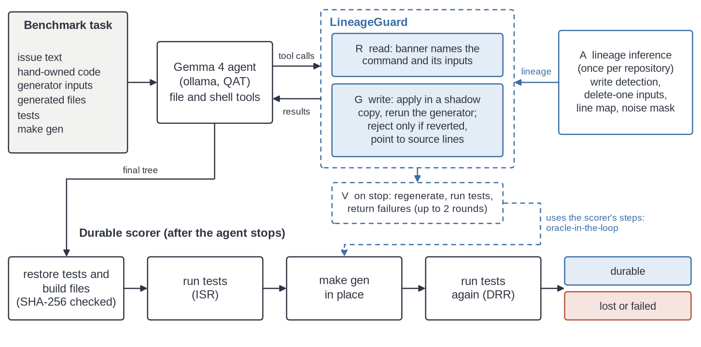
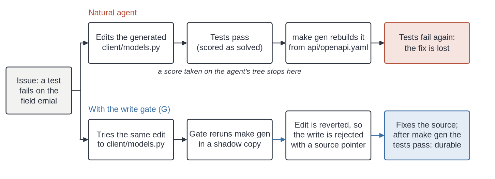

# The Fix That Disappears

**GenLineage-Bench and LineageGuard: a benchmark and a write gate for coding agent fixes that code regeneration reverts.**

[](LICENSE)
[](https://www.python.org/downloads/)

[Paper (PDF)](paper/GenLineage_paper.pdf) | [Kaggle notebook](https://www.kaggle.com/code/pettuganihotragn/genlineage-the-fix-that-disappears) | [Code](https://github.com/Hotragn/genlineage-bench) | [Preregistration](PREREGISTRATION.md)

Hotragn Pettugani. Kaggle Gemma 4 Developer Agent Paper Track, 2026.



## Overview

Coding agents are scored by running the tests on the tree they leave behind. Many repositories commit generated code, such as protobuf stubs, OpenAPI clients and parser tables. In these repositories the tree is not stable: the next `make gen` rebuilds the generated files from their sources and reverts any fix written into them. The tests passed, the task was scored as solved, and the fix is gone after the next build.

This repository contains:

- **GenLineage-Bench**: 19 test tasks and 7 dev tasks. Each is a small Python repository whose generated files come from a real, version-pinned generator (grpcio-tools, datamodel-code-generator, Jinja2, Lark, and a preserved-region generator).
- **A durable scorer** (`genlineage/score.py`): restore the tests and build files (SHA-256 checked), run the tests, run `make gen`, and run the tests again.
- **LineageGuard** (`genlineage/lineage.py`, `genlineage/agent.py`): lineage inference by running the generator counterfactually (A), read-time banners (R), survival-gated writes (G) and regenerate-then-verify (V), plus the baselines from the paper (hint, HeaderGuard, StaticBlock, VerifyTests).
- **All released runs and the analysis**: 835 agent transcripts with Gemma 4 E2B, E4B and 12B, and a claims checker that recomputes every number in the paper from them.



## Key results

Regen and mixed tasks (13 tasks), seeds 1 and 2, pooled over the three Gemma 4 models. DRR is the preregistered durable repair rate: the original tests pass after `make gen`, and no test file was modified. DFR is the share of passing fixes that fail after regeneration.

| Condition | DRR | Durable runs | DFR |
|---|---|---|---|
| natural (no help) | 34% | 26 of 77 | 62% |
| hint (one prompt sentence) | 45% | 35 of 78 | 42% |
| HeaderGuard (header-based blocker) | 44% | 34 of 78 | 42% |
| R+G (LineageGuard write gate) | 69% | 54 of 78 | 0% |
| R+G+V (full LineageGuard, upper bound) | 82% | 64 of 78 | 0% |

- Under natural prompting, 31 of 50 passing fixes disappeared on regeneration, and all 31 had edited only generated files.
- Full LineageGuard against natural: +48 points [+30, +67], task-level Holm p 0.0015. R+G+V is an oracle-in-the-loop upper bound, because V reuses the scorer's procedure.
- The per-model tests are significant on E2B and E4B but not on 12B (Holm p 0.2).
- In the AIDev dataset, 4,965 of 359,735 agent pull requests (1.4%) edit a file marked as generated.

Per-model tables, strict DRR (pass both before and after regeneration) and the ablations are in the paper.

## Quickstart

Linux, Python 3.13, CPU only. The first call creates `.venv` and installs the pinned generators.

```bash
git clone https://github.com/Hotragn/genlineage-bench && cd genlineage-bench
./reproduce.sh validate       # rebuild and validate every task, prints "VALIDATE ALL OK"
./reproduce.sh guard-tests    # survival gate on every reference fix and generated-only fix
```

## Reproduce the paper

```bash
./reproduce.sh paper          # recompute every number from raw transcripts, render the paper, audit it, cross-check
./reproduce.sh figures        # redraw the four paper figures into paper/figures
sha256sum -c PREREGISTRATION.sha256
```

`paper/GenLineage_paper.pdf` is rendered from `paper/writeup.md` by `scripts/make_pdf.py` (needs `markdown` and `weasyprint`).

`kaggle/notebook/genlineage_paper.ipynb` does the same in a notebook, with no GPU, and ends with a small live demo of the scorer and the write gate.

`./reproduce.sh paper` runs `scripts/check_claims.py`. It recomputes all statistics into `results/summary/paper_stats.json`, renders `paper/writeup_template.md`, and fails unless the result matches `paper/writeup.md` byte for byte. It then runs `scripts/paper_audit.py` (word count, forbidden characters, unexplained numbers, figure files) and `scripts/cross_check.py` (cell counts against two independently written analyses).

To rerun agents, start an ollama server with a Gemma 4 checkpoint. A GPU is recommended; the paper runs used two Kaggle T4 GPUs.

```bash
ollama pull gemma4:e4b-it-qat
OLLAMA_URL=http://127.0.0.1:11434 ./reproduce.sh grid gemma4:e4b-it-qat e4b 1
./reproduce.sh analyze
```

The fixed agent configuration is `CONFIG` in `genlineage/agent.py`. `kaggle/make_kernel.py` builds the exact Kaggle runner used for the paper grid.

## Repository layout

```
bench/families.py        task definitions: sources, generators, tests, issues, reference fixes
bench/build.py           builds bench/tasks/<id>/ by running the generators; --validate-only checks every task
bench/tasks_real/        four tasks built from pycparser and yt-dlp (bench/build_real.py, bench/fetch_real.py)
genlineage/score.py      immediate and durable scoring, tamper checks
genlineage/lineage.py    lineage inference, source-line pointer, shadow-regeneration survival check
genlineage/agent.py      ollama tool-calling agent and the nine conditions
lineage_graph/           NetworkX export of the inferred lineage for the 19 test tasks
realrepo/                lineage inference on seven open-source projects
inthewild/, prevalence/  AIDev pull request mining and hand audit; SWE-bench Verified scan
kaggle/                  Kaggle runner template, kernel builder, the two grid kernels used for the paper, and the paper notebook
results/                 released transcripts (runs, runs_ladder, runs_real) and summaries
scripts/                 grid runner, analysis, claims checker, figures
paper/                   writeup template, rendered writeup, PDF, references, figures
```

## Task format

Each task lives in `bench/tasks/<id>/`:

- `repo/`: the starting repository, with a `Makefile` whose `gen` target runs the generator.
- `task.json`: the issue text, the task kind (`regen`, `inregion`, `mixed` or `control`), which files are generated and which are their sources, the reference fix, a generated-file-only fix, SHA-256 hashes of the test files, the build files and the known noise lines.
- `ref_outputs/`: generator outputs for the reference fix.

For example, in `oa1_property_typo` the OpenAPI spec misspells `email` as `emial`. The reference fix edits `api/openapi.yaml`; the generated-file-only fix edits `client/models.py`, which passes the tests now and fails after `make gen`.

## Adding a task

1. Add a `task(...)` entry to `bench/families.py` with the repository files, `generated`, `sources`, `ref_fix` and, if a hand edit to a generated file would pass, `gen_only_fix`.
2. Run `PYTHONHASHSEED=0 PATH=$PWD/bin:$PATH .venv/bin/python bench/build.py <task_id>`. This builds `bench/tasks/<task_id>/` and validates it.
3. A task is valid when regeneration of the untouched repository is deterministic, the untouched repository fails, the reference fix passes before and after regeneration and fixes the root cause, and the generated-file-only fix (if given) passes now and fails after regeneration.
4. Run `./reproduce.sh validate` to check that every task still passes.

## Preregistration

`PREREGISTRATION.md` fixes the primary outcome (DRR on the 13 regen and mixed tasks), the three primary contrasts and the tests. Its SHA-256 begins `8d51143c` and is stored in `PREREGISTRATION.sha256`. The plan was written on our own machine before any grid output was seen, so its first public timestamp is this repository's release. Deviations from the plan are listed in Section 9 of the paper.

## Citation

```bibtex
@misc{pettugani2026fixdisappears,
  author       = {Hotragn Pettugani},
  title        = {The Fix That Disappears: A Benchmark and a Write Gate for Agent Fixes That Regeneration Reverts},
  year         = {2026},
  howpublished = {Kaggle, Gemma 4 Developer Agent Paper Track},
  note         = {Code: https://github.com/Hotragn/genlineage-bench}
}
```

## License

Apache License 2.0; see `LICENSE`. Generated code inside the tasks is produced by third-party generators under their own licenses. The real-repository tasks keep the upstream licenses of pycparser (BSD-3-Clause) and yt-dlp (Unlicense). The two yt-dlp tasks do not ship the upstream snapshot, because upstream hardcodes public service keys in some extractors. They keep only the files we changed or added, and `bench/fetch_real.py` downloads yt-dlp at the pinned commit and checks every file against `upstream_manifest.json` (`./reproduce.sh validate-real`). Agent runs on the real tasks fetch automatically.

## Acknowledgements

We thank the Gemma team for the open Gemma 4 checkpoints, Kaggle for GPU time, the authors of the AIDev dataset, and the maintainers of grpcio-tools, datamodel-code-generator, Jinja2, Lark, pycparser and yt-dlp.
