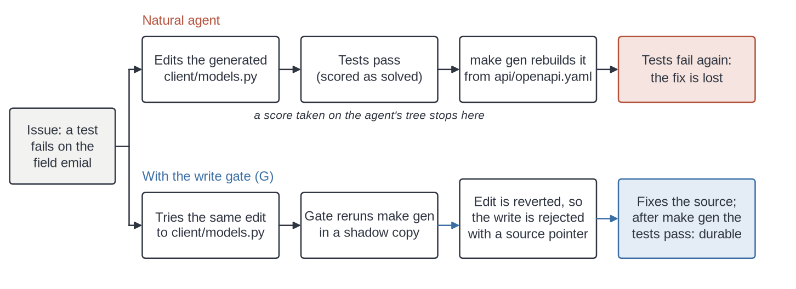
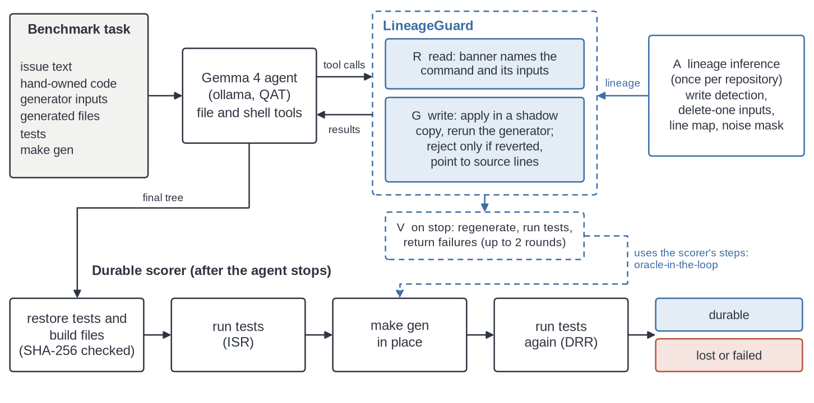
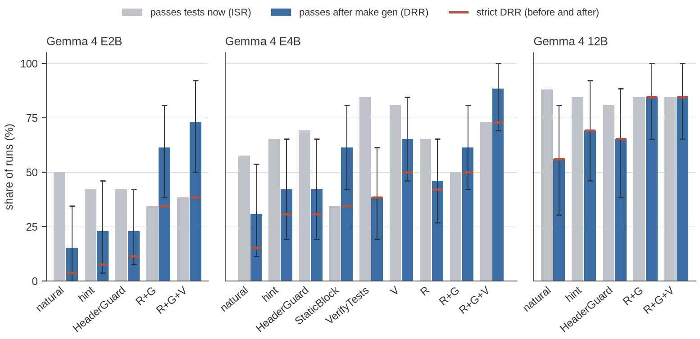
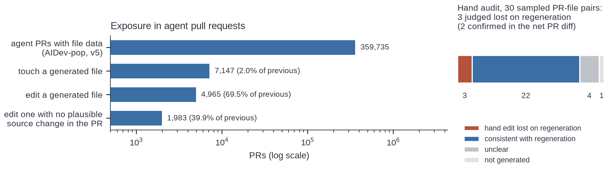

# The Fix That Disappears
*A benchmark and a write gate for agent fixes that regeneration reverts*

## Abstract
Coding agents are scored by running the tests on the tree they leave behind. In repositories that commit generated code (protobuf stubs, OpenAPI clients, parser tables), that tree is not stable: the next `make gen` rebuilds generated files from their sources and reverts any fix written into them. GenLineage-Bench (19 validated tasks over real generators) scores a repair by rerunning the generator, then the tests. Unaided Gemma 4 E2B, E4B and 12B agents passed in 50 of 77 runs on generator-dependent tasks, and 31 of those fixes disappeared on regeneration; all 31 had edited only generated files. LineageGuard runs the generator counterfactually to infer lineage and rejects only writes that regeneration would revert. The preregistered durable repair rate rose from 34% (natural), 45% (a prompt hint) and 44% (a header-based guard) to 82% with full LineageGuard (pooled task-level Holm p at most 0.0039; strict DRR 25% to 65%). This is an upper bound, since its final check reuses the scorer's procedure, and per-model tests are significant on E2B and E4B, not 12B. The write gate alone, which never runs the tests, reached 69%; on E4B a static block pointing to the source matched it, so the gain is localization. Of 359,735 real agent pull requests, 4,965 edit a file marked as generated.

## 1. Introduction
A Gemma 4 agent is asked to fix an API client. A test fails on a misspelled field in `client/models.py`, so the agent corrects the field there and the tests pass. But `client/models.py` is generated from `api/openapi.yaml`, which still has the typo, and the next `make gen`, in someone else's build, restores the bug (Figure 1). No test on the agent's tree can catch this, because the patch is correct today.

*Figure 1. A passing fix that regeneration reverts, and the gated path to the source.*

It happens in practice. A review agent read a file headed `GENERATED from pre-review.src.sh -- DO NOT EDIT` in every run without flagging that a pull request's edits to it would be lost [fullsend2026issue1022], and a coding agent that could not run a generator hand-edited two generated files [konflux2026issue373]. Practitioners respond with labels: AGENTS.md rules [packer2026agentsmd], path hooks [rstudio2026hook] and header blockers [dsh2026protect]. Labels miss headerless files, misfire on hand-written ones [ohmypi2026pr13139], and cannot tell a correct edit inside a preserved region from one outside it. Standard benchmarks rarely test this (1 of 500 SWE-bench Verified instances touches a committed generated file), yet the companion competition grades the same way (apply the diff, run pytest), and rich, one of its repositories, commits generated Unicode width tables.

## 2. Problem and metrics
A repository holds hand-owned files, generator inputs and generated files produced by a committed command, here `make gen`. After the agent finishes, we restore the original tests and build files (SHA-256 checked), run the tests, run `make gen` in place, and run the tests again.
- **Immediate success rate (ISR)**: tests pass on the agent's tree.
- **Durable repair rate (DRR, preregistered primary)**: tests pass after regeneration, and no test file was modified. A *latent* fix (source fixed, outputs left stale) fails now but passes after regeneration. It counts as durable: the next build delivers it.
- **Strict DRR (secondary)**: passes both before and after regeneration.
- **Disappearing-fix rate (DFR)**: share of immediate passes that fail after regeneration.
- **Hand edits (HEG)**: the run edited a generated file. Test tampering is reported separately; because tests are restored, it never yields a pass.

## 3. GenLineage-Bench
Each task is a small Python repository around a real generator: protobuf (grpcio-tools 1.85.1), OpenAPI (datamodel-code-generator 0.92.0), Jinja2 3.1.6 templates, a Lark 1.3.1 standalone parser, and a round-trip generator we wrote that preserves `USER CODE` regions. The test split has 19 tasks: 12 *regen* (the fix belongs in a generator input), 2 *in-region* (the fix belongs inside a preserved region of a generated file), 1 *mixed* and 4 *controls* (a bug in hand-owned code, so refusing every edit fails). Headers and AGENTS.md vary; 3 regen tasks have no header. 7 more dev tasks only built the harness.

Validation is mechanical (26 of 26 tasks pass). The untouched repository fails, the reference fix passes both checks, a generated-file-only patch (12 of 13 regen and mixed tasks) passes now and fails after regeneration, and regeneration is deterministic up to a noise mask. Shell commands are diffed, so shell edits count as hand edits.

## 4. LineageGuard

*Figure 2. LineageGuard reruns the generator in a copy at A, R, G and V; the scorer regenerates, then tests.*

**A. Lineage inference (once per repository; Figure 2).** We run the generation command in a sandbox. Its outputs are the files it writes; two runs measure line noise. Deleting each other file in turn marks the inputs; for small data-like inputs, deleting single lines maps output lines to source lines. No headers or names are used. On our tasks this takes 15 to 52 generator runs (median 4.5 s on CPU). The lineage is also exported as a NetworkX graph (`produced_by`, `generated_from`, `derived_from` and `part_of` edges over file, command and line nodes). The competition's code graphs link Python symbols, so a generated module has no edge to its `.proto` or YAML source; these edges supply it. No agent queried the graph; lineage reached agents only through R and G.

**R. Read-time banners.** `list_files` and `read_file` mark generated files with their command and inputs.

**G. Survival-gated writes.** A write to a generated file is applied in a shadow copy and the generator is rerun. The write is rejected only if regeneration reverts it, with a pointer to the source lines, so edits inside preserved regions go through. Shell edits are checked the same way.

**V. Regenerate-then-verify.** When the agent stops, we regenerate a shadow copy, run the tests and return any failures (at most 2 more rounds). V runs the scorer's own procedure, so conditions with V are oracle-in-the-loop upper bounds.

## 5. Setup and statistics
**Agent.** A minimal tool-calling agent (list_files, read_file, write_file, replace_in_file, run_tests, run_command) over ollama 0.40.16 with Gemma 4 QAT checkpoints (`gemma4:e2b-it-qat`, `gemma4:e4b-it-qat`, `gemma4:12b-it-qat`) on two Kaggle T4 GPUs: temperature 0.7, thinking off, 16,384-token context, 2,048 output tokens per step and at most 25 steps. This is not the competition's ADK harness or checkpoints, though our tools mirror its file and shell tools. 31B was not run: the weekly GPU quota allowed one five-hour session.

**Conditions.** *natural*; *hint* (a system-prompt sentence: generated files are rebuilt, fix sources); *HeaderGuard* (re-implements dsh-protect-generated-files: header regex over 15 lines plus protobuf names, deny with a hint); *StaticBlock* (G's rejection message on every generated-file write, without regeneration, so in-region edits are blocked too); *VerifyTests* (V's extra rounds, tests only); *V*; *R*; *R+G* (the gate); *R+G+V* (full LineageGuard). E4B ran all nine; E2B and 12B the first three and the last two.

**Runs.** 835 runs completed (E2B 190, E4B 456, 12B 189), with 1 infrastructure error excluded. Seeds 1 and 2, complete everywhere, are the primary data; E4B's partial seed 3 (12 or 13 tasks per condition) is a robustness check.

**Plan.** The preregistration (SHA-256 `8d51143c`) fixes the outcome, DRR on the 13 regen and mixed tasks, and three primary contrasts (natural, hint and HeaderGuard, each against R+G+V), tested per model by exact McNemar on (task, seed) pairs with Holm adjustment. A pre-results amendment added HeaderGuard vs R+G as the oracle-free mechanism contrast, and permutation p values. Seeds are unmatched at temperature 0.7 and tasks are shared across models, so we lead with a pooled exact sign-flip permutation test with tasks as units (13 units, each a mean paired difference; Holm over the three primaries) and also report model-task units and the planned per-model tests. Everything else is exploratory; intervals are bootstraps clustered by task.

## 6. Results
### 6.1 Passing fixes disappear
**Table 1.** Regen and mixed tasks, seeds 1 and 2 (26 runs per cell; 12B natural 25). Percent of runs; DRR with task-clustered 95% interval. R+G+V is an oracle-in-the-loop upper bound; strict DRR is in Figure 3.

| Model | Condition | ISR | DRR [95% CI] | DFR |
|---|---|---|---|---|
| E2B | natural | 50 | 15 [0, 35] | 92 |
| E2B | hint | 42 | 23 [4, 46] | 73 |
| E2B | HeaderGuard | 42 | 23 [8, 42] | 73 |
| E2B | R+G | 35 | 62 [38, 81] | 0 |
| E2B | R+G+V | 38 | 73 [50, 92] | 0 |
| E4B | natural | 58 | 31 [12, 54] | 73 |
| E4B | hint | 65 | 42 [19, 65] | 53 |
| E4B | HeaderGuard | 69 | 42 [19, 65] | 50 |
| E4B | R+G | 50 | 62 [42, 81] | 0 |
| E4B | R+G+V | 73 | 88 [69, 100] | 0 |
| 12B | natural | 88 | 56 [30, 81] | 36 |
| 12B | hint | 85 | 69 [46, 92] | 18 |
| 12B | HeaderGuard | 81 | 65 [38, 88] | 19 |
| 12B | R+G | 85 | 85 [65, 100] | 0 |
| 12B | R+G+V | 85 | 85 [65, 100] | 0 |

Under natural prompting, `make gen` reverted 31 of 50 passing fixes (62%). DFR falls with model size (E2B 92%, E4B 73%, 12B 36%) but persists, and 58% of natural runs hand-edited a generated file. A reward computed on the agent's tree would have paid all 31. Latent fixes explain why DRR exceeds surviving passes: 7 natural runs fixed a source without regenerating.

*Figure 3. Immediate pass rate, DRR with 95% interval, and strict DRR (tick).*

### 6.2 Primary contrasts
Pooled over models, full LineageGuard raised DRR from 34% to 82% against natural (39 vs 2 discordant pairs, +48 points [+30, +67], task-level Holm p 0.0015), from 45% against the hint (32 vs 3, +37 [+19, +58], p 0.0039) and from 44% against HeaderGuard (33 vs 3, +38 [+22, +56], p 0.0039). With model-task units all three Holm p are <0.001, and under strict DRR the task-level p are at most 0.0088. Paired changes use only complete (model, task, seed) pairs, so may differ slightly from marginal rates.

**Table 2.** Per-model DRR change in points (R+G+V or R+G minus baseline), with discordant pairs (treatment-only:baseline-only) and unadjusted task-level permutation p.

| Model | natural vs R+G+V | hint vs R+G+V | HeaderGuard vs R+G+V | HeaderGuard vs R+G |
|---|---|---|---|---|
| E2B | +58 (15:0; 0.0039) | +50 (13:0; 0.0078) | +50 (13:0; 0.0039) | +38 (12:2; 0.016) |
| E4B | +58 (15:0; 0.002) | +46 (13:1; 0.02) | +46 (12:0; 0.016) | +19 (8:3; 0.27) |
| 12B | +28 (9:2; 0.17) | +15 (6:2; 0.44) | +19 (8:3; 0.38) | +19 (8:3; 0.38) |

Per model, the planned McNemar tests agree on E2B and E4B (all Holm p at most 0.0018). On 12B no contrast is significant (natural vs R+G+V Holm p 0.2), so we claim no 12B effect. Adding E4B seed 3 changes nothing (natural vs R+G+V +54 points [+34, +73], p 0.002).

### 6.3 What helps without the grader
The gate alone (R+G) reruns the generator but never the tests (every condition can call run_tests). It reached 69% pooled, above HeaderGuard (28 vs 8, +26 points, task-level p 0.022), the hint (26 vs 7, p 0.047) and natural (31 vs 4, p 0.0078). These are secondary; per model the mechanism contrast is significant only on E2B (Table 2).

Under any gate DFR is 0 by construction. The cost is more failing runs that change no file (7 of 77 natural, 15 of 78 under R+G). In exploratory E4B ablations, StaticBlock, which shows the same source pointer without regeneration, tied the gate on regen and mixed tasks (62% vs 62%, 4 vs 4 discordant pairs; natural 31%, HeaderGuard 42%). There the gain comes from lineage-derived localization, not from the survival check. The check may matter where the fix belongs inside a generated file: on in-region tasks, which natural agents solved (4 of 4), StaticBlock solved 1 of 4 and the gate 4 of 4 (untested). V alone reached 65% against 38% for test-only extra rounds (9 vs 2, p 0.092), and V on top of the gate added more (7 vs 0, p 0.016). Banners alone (R) reached 46%; agents still write to outputs labeled generated.

**Headerless files.** On the 3 regen tasks without a header, pooled DRR was 1 of 18 runs under natural, 1 under the hint, 2 under HeaderGuard, 12 under the gate and 15 under R+G+V (gate vs HeaderGuard 12 vs 2, p 0.062; exploratory). HeaderGuard cannot see these files (15 of its 17 passes there disappeared), yet it blocked a hand-owned source 4 times (templates matching its header rules); the survival gate blocked none.

### 6.4 Harm, tampering and cost
On the 4 control tasks, DRR was 22 of 24 (natural), 18 of 24 (hint), 23 of 24 (HeaderGuard), 24 of 24 (gate) and 23 of 24 (R+G+V): no gross harm. Test tampering, on all 19 tasks and the same seeds, was rare and not reduced: 4 of 113 natural runs (3.5%), 4 of 114 hint, 7 of 114 HeaderGuard, 2 of 114 gate and 6 of 114 R+G+V. 12B never tampered, and no build file was altered. A mean E4B run took 9.1 steps, 17.0k tokens and 31 s under natural, 8.7, 14.9k and 30 s under the gate, and 10.0, 19.9k and 35 s under R+G+V.

### 6.5 Signal ladder and noise floor
Natural E4B ran the 13 regen and mixed tasks with no signal (L0), a do-not-edit header (L1) or header plus AGENTS.md (L2), 26 runs each. DRR was 5, 16 and 10 of 26. A header helped (discordant 11 vs 0, p <0.001). The agent opened AGENTS.md in 0 of 26 L2 runs [yang2026contribrules], yet L2 scored below L1 (0 vs 6, p 0.031). An unread file moving 6 of 26 outcomes sets a noise floor; per-model contrasts of that size deserve caution, and the pooled primaries (39 vs 2, 32 vs 3) exceed it.

## 7. Beyond the benchmark
**Real repositories.** Lineage inference ran on 7 open-source projects (aiohttp, black, pygments, rich, gRPC helloworld, pycparser, yt-dlp). On pycparser and yt-dlp, write detection found 9 of 9 declared outputs with 0 noise lines, and the gate classified 9 of 9 spot-check edits as expected, two of them in yt-dlp's README, which mixes hand-written and generated text, so any file-level label misjudges one. Negatives: delete-one ablation cannot separate inputs from imports for code-first generators (every yt-dlp module deletion crashes the generator).

**Real-repository tasks (negative).** We built 4 validated tasks by injecting bugs into generator inputs of pycparser and yt-dlp. HeaderGuard's rules match 0 of their 9 generated files (pycparser's header says "automatically generated ... Do not modify it directly"; yt-dlp's outputs have none). In 4 E4B CPU runs on pycparser the agent solved 0 and 2 modified tests (generated `c_ast.py` has 1,666 lines; prompts reached 170k tokens). They are not durability evidence; we release them for larger models.

**Agent pull requests in the wild.** In AIDev v5 [li2026aidev], 4,965 of 359,735 agent pull requests (1.4%) edit a file that path or header rules mark as generated, and 1,983 change no plausible source. A hand audit of 30 of these found 22 consistent outputs of code-first generators, 3 hand edits that regeneration would revert, 4 unclear and 1 not generated. One of the 3 came from a regeneration commit, so 2 are confirmed (Wilson 95% CI 1.8 to 21.3%). Of 181 path-detected generated files, 39.8% carry no do-not-edit header in their first 15 lines and 32.6% are invisible to HeaderGuard's rules. Labels mis-predict loss both ways, so this measures exposure, not loss.

*Figure 4. Agent pull requests touching generated files (log scale) and the hand audit.*

## 8. Related work
**Oracles.** SWE-bench [jimenez2024swebench], live variants [zhang2025swelive] and scaffolds [yang2024sweagent; xia2025agentless; wang2025openhands] score the post-edit tree, and training rewards inherit it [pan2025swegym; wei2025swerl]. Critiques expose wrong patches [wang2026solved], weak tests [yu2025utboost] and test exploitation [zhong2026impossiblebench]. They strengthen the tests, while we first rerun the repository's generator. Projects run regenerate-and-diff CI checks [kubernetes2026verifycodegen; azure2026pr840], but no agent benchmark applies them, and a diff check rejects legitimate preserved-region edits.

**Durability.** SWE-Maintain [pan2026swemaintain] and SWE-CI [chen2026sweci] follow agent code across later tasks, and SWE-Touch injects user edits mid-task [tan2026swetouch]. None reruns a repository operation right after the repair.

**Boundaries.** Prompt-level awareness is not enough without constrained affordances [trong2026swemisbehavior], boundary contracts leave enforcement open [eun2026boundary], and context files help little [gloaguen2026agentsmd]. Code-graph localizers [chen2025locagent; ouyang2025repograph] also lack these edges.

**Builds and round trips.** Build tools infer dependencies by tracing [spall2020perfect; fan2020escaping]; we use write detection and delete-one ablation [zeller2002dd]. Protected regions preserve hand edits by generator design [greifenberg2015integration; predoaia2025preservation].

## 9. Limitations and deviations
- **Scope.** Small Python repositories we wrote around real generators; 13 primary tasks give wide intervals; one model family and harness. R+G+V is an upper bound, and the survival check's benefit rests on few in-region runs.
- **The generator must run.** A and G need a supplied, runnable, deterministic command; discovery found 0 of 4 real commands [konflux2026issue373].
- **Deviations.** We lead with a pooled permutation test, not per-model McNemar; seeds 1 and 2 are primary, while the plan used all completed pairs; strict DRR is added. The one infrastructure error was not rerun (no quota). Root-cause-fix rates and factor breakdowns are only in released summaries; per-write gate latency is unreported. E4B seed 3 is partial, and the ladder ran on CPU. The grid was launched nine minutes before the plan was written, though no output had been seen, and the plan has no public timestamp earlier than the repository release.

## 10. Reproducibility and release
Code, tasks, transcripts, lineage graphs and analysis are released under Apache 2.0 at https://github.com/Hotragn/genlineage-bench (Kaggle notebook: https://www.kaggle.com/code/pettuganihotragn/genlineage-the-fix-that-disappears). `scripts/check_claims.py` recomputes every number here from raw transcripts and fails on any mismatch.

## References
- [azure2026pr840] Microsoft Azure. Azure/azure-openapi-validator pull request 840. GitHub pull request 2026. https://github.com/Azure/azure-openapi-validator/pull/840
- [chen2025locagent] Chen et al. LocAgent: Graph-Guided LLM Agents for Code Localization. ACL 2025. https://doi.org/10.18653/v1/2025.acl-long.426
- [chen2026sweci] Chen et al. SWE-CI: Evaluating Agent Capabilities in Maintaining Codebases via Continuous Integration. arXiv preprint 2603.03823 2026. https://arxiv.org/abs/2603.03823
- [dsh2026protect] acus9345. dsh-protect-generated-files. GitHub repository, harness plug-in 2026. https://github.com/acus9345/dsh-protect-generated-files
- [eun2026boundary] Eun et al. Toward Bounding Coding-Agent Autonomy in Software Maintenance: A Pilot Study of Boundary Contracts. JAWS 2 workshop; arXiv 2611.01265 2026. https://arxiv.org/abs/2611.01265
- [fan2020escaping] Fan et al. Escaping Dependency Hell: Finding Build Dependency Errors with the Unified Dependency Graph. ISSTA 2020. https://doi.org/10.1145/3395363.3397388
- [fullsend2026issue1022] fullsend-ai-retro[bot]. Correctness sub-agent should detect edits to generated files and verify test targets. GitHub issue fullsend-ai/agents 1022 2026. https://github.com/fullsend-ai/agents/issues/1022
- [gloaguen2026agentsmd] Gloaguen et al. Evaluating AGENTS.md: Are Repository-Level Context Files Helpful for Coding Agents? ICLR 2026 workshop; arXiv 2602.11988 2026. https://arxiv.org/abs/2602.11988
- [greifenberg2015integration] Greifenberg et al. A Comparison of Mechanisms for Integrating Handwritten and Generated Code for Object-Oriented Programming Languages. MODELSWARD 2015. https://doi.org/10.5220/0005239700740085
- [jimenez2024swebench] Jimenez et al. SWE-bench: Can Language Models Resolve Real-World GitHub Issues? ICLR 2024. https://arxiv.org/abs/2310.06770
- [konflux2026issue373] Konflux CI. konflux-ci/konflux-operator-tasks issue 373. GitHub issue 2026. https://github.com/konflux-ci/konflux-operator-tasks/issues/373
- [kubernetes2026verifycodegen] The Kubernetes Authors. hack/verify-codegen.sh (regenerate and fail if generated files are stale). GitHub repository file 2026. https://github.com/kubernetes/kubernetes/blob/master/hack/verify-codegen.sh
- [li2026aidev] Li et al. AIDev: Studying AI Coding Agents on GitHub. MSR 2026. https://doi.org/10.1145/3793302.3797249
- [ohmypi2026pr13139] can1357. can1357/oh-my-pi pull request 13139. GitHub pull request 2026. https://github.com/can1357/oh-my-pi/pull/13139
- [ouyang2025repograph] Ouyang et al. RepoGraph: Enhancing AI Software Engineering with Repository-level Code Graph. ICLR 2025. https://arxiv.org/abs/2410.14684
- [packer2026agentsmd] HashiCorp. Packer AGENTS.md (generated code rules). GitHub repository file 2026. https://github.com/hashicorp/packer/blob/main/AGENTS.md
- [pan2025swegym] Pan et al. Training Software Engineering Agents and Verifiers with SWE-Gym. ICML 2025. https://arxiv.org/abs/2412.21139
- [pan2026swemaintain] Pan et al. Do Modifications Made by Coding Agents Make Subsequent Software Maintenance Harder? arXiv preprint 2610.14768 2026. https://arxiv.org/abs/2610.14768
- [predoaia2025preservation] Predoaia et al. Hand-Written Code Preservation in Model-to-Text Transformation Using Intrinsic Redundancy. MODELS 2025. https://doi.org/10.1109/models67397.2025.00021
- [rstudio2026hook] RStudio. block-edit-autogenerated-files.sh (Claude Code PreToolUse hook). GitHub repository file 2026. https://github.com/rstudio/rstudio/blob/main/.claude/hooks/block-edit-autogenerated-files.sh
- [spall2020perfect] Spall et al. Build Scripts with Perfect Dependencies. Proc. ACM Program. Lang. (OOPSLA) 2020. https://doi.org/10.1145/3428237
- [tan2026swetouch] Tan et al. SWE-Touch: Benchmarking Coding Agents When Users Touch the Code. arXiv preprint 2608.02499 2026. https://arxiv.org/abs/2608.02499
- [trong2026swemisbehavior] Trong et al. SWE-Misbehavior: Benchmarking and Mitigating Boundary Violations in Software Coding Agents. arXiv preprint 2610.18206 2026. https://arxiv.org/abs/2610.18206
- [wang2025openhands] Wang et al. OpenHands: An Open Platform for AI Software Developers as Generalist Agents. ICLR 2025. https://arxiv.org/abs/2407.16741
- [wang2026solved] Wang et al. Are "Solved Issues" in SWE-bench Really Solved Correctly? An Empirical Study. ICSE 2026. https://doi.org/10.1145/3744916.3764576
- [wei2025swerl] Wei et al. SWE-RL: Advancing LLM Reasoning via Reinforcement Learning on Open Software Evolution. NeurIPS 2025. https://doi.org/10.52202/085713-2629
- [xia2025agentless] Xia et al. Demystifying LLM-Based Software Engineering Agents. Proc. ACM Softw. Eng. (FSE) 2025. https://doi.org/10.1145/3715754
- [yang2024sweagent] Yang et al. SWE-agent: Agent-Computer Interfaces Enable Automated Software Engineering. NeurIPS 2024. https://arxiv.org/abs/2405.15793
- [yang2026contribrules] Yang et al. A First Look at Coding Agents' Compliance with AI Contribution Rules in Open-Source Communities. arXiv preprint 2607.26819 2026. https://arxiv.org/abs/2607.26819
- [yu2025utboost] Yu et al. UTBoost: Rigorous Evaluation of Coding Agents on SWE-Bench. ACL 2025. https://doi.org/10.18653/v1/2025.acl-long.189
- [zeller2002dd] Zeller et al. Simplifying and Isolating Failure-Inducing Input. IEEE TSE 2002. https://doi.org/10.1109/32.988498
- [zhang2025swelive] Zhang et al. SWE-bench Goes Live! NeurIPS 2025. https://doi.org/10.52202/085713-4923
- [zhong2026impossiblebench] Zhong et al. ImpossibleBench: Measuring LLMs' Propensity of Exploiting Test Cases. ICLR 2026. https://arxiv.org/abs/2510.20270
